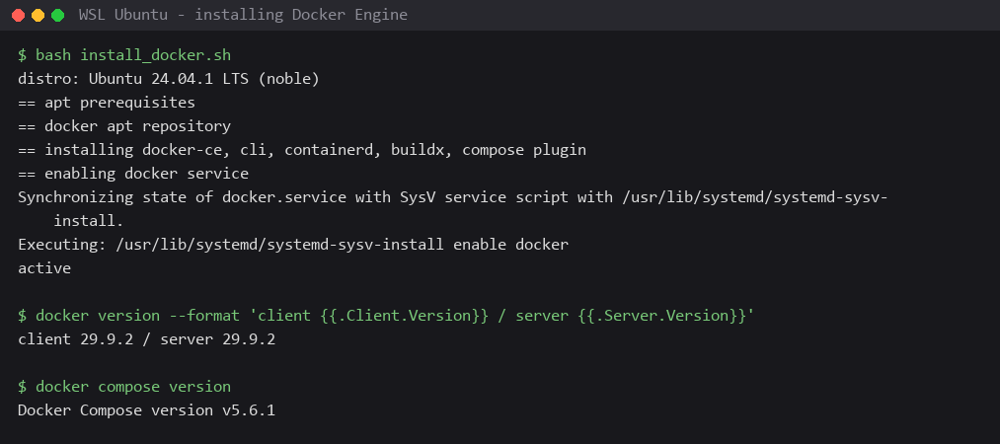
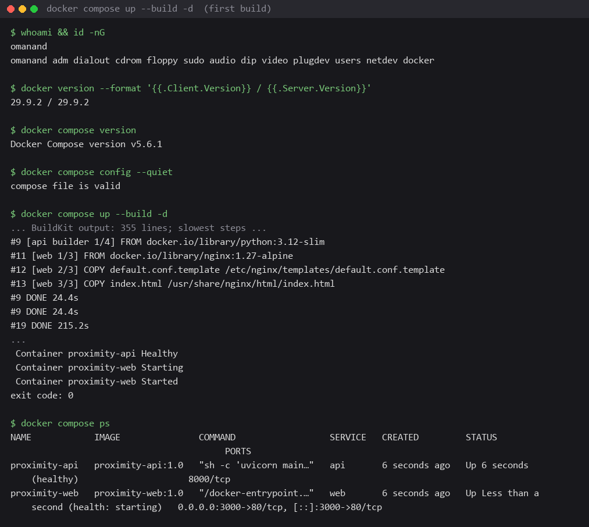
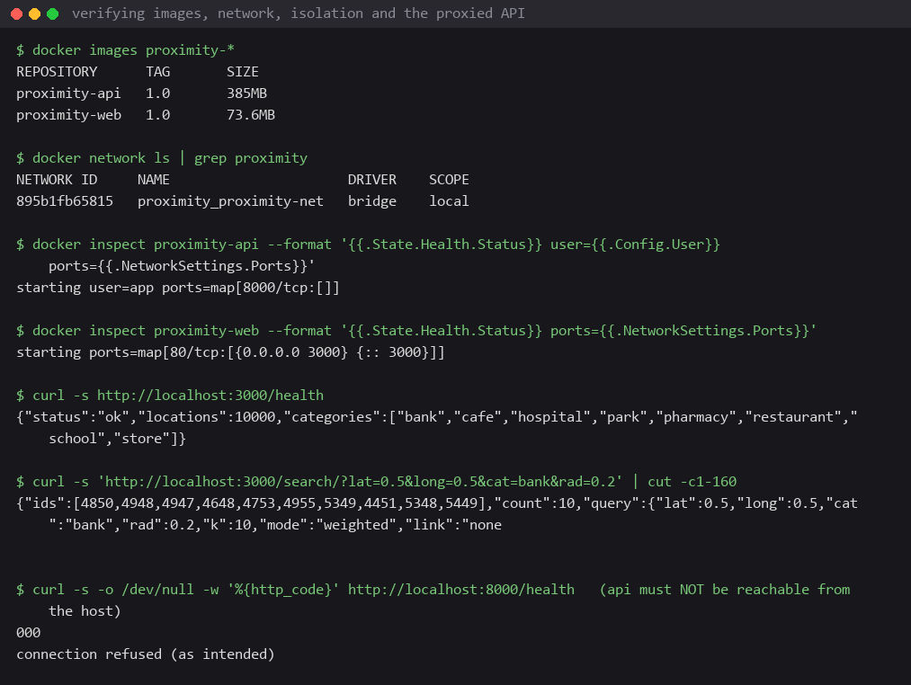
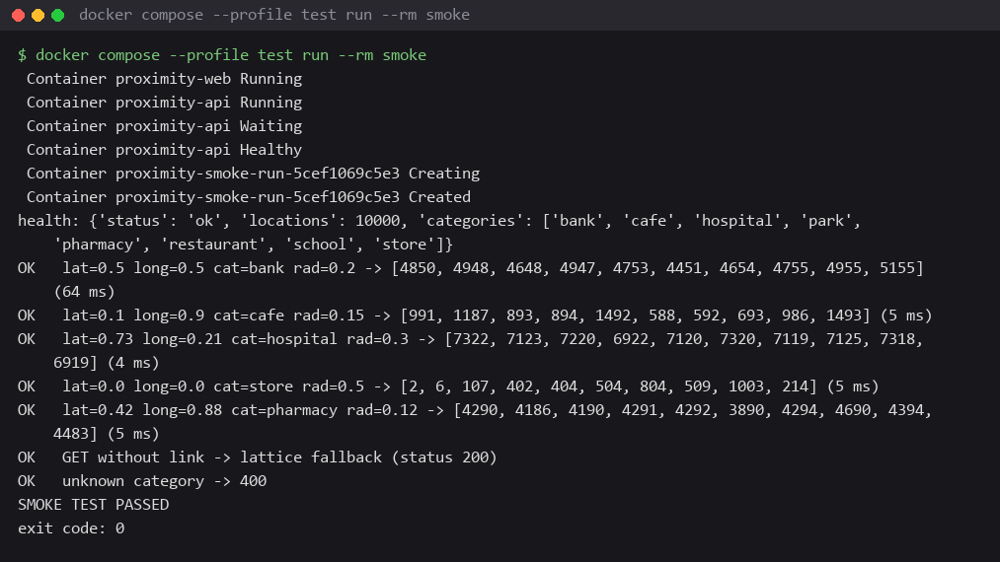
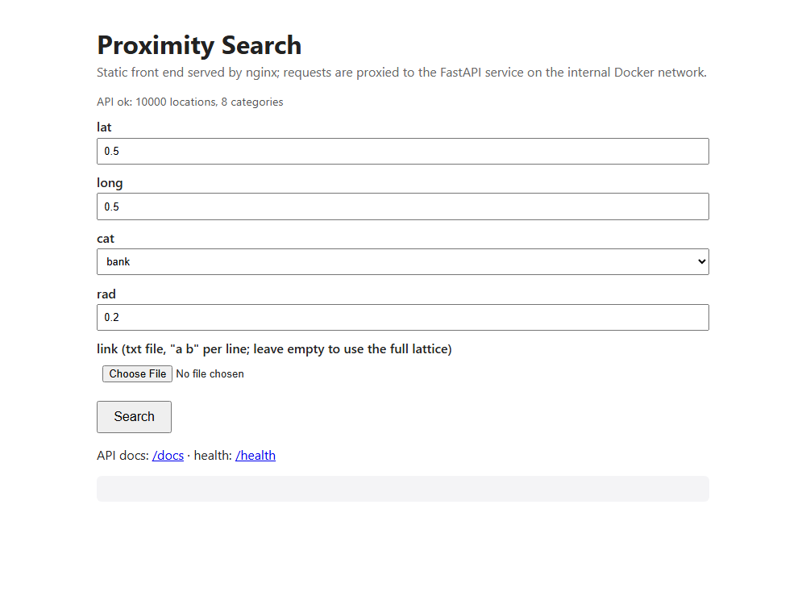
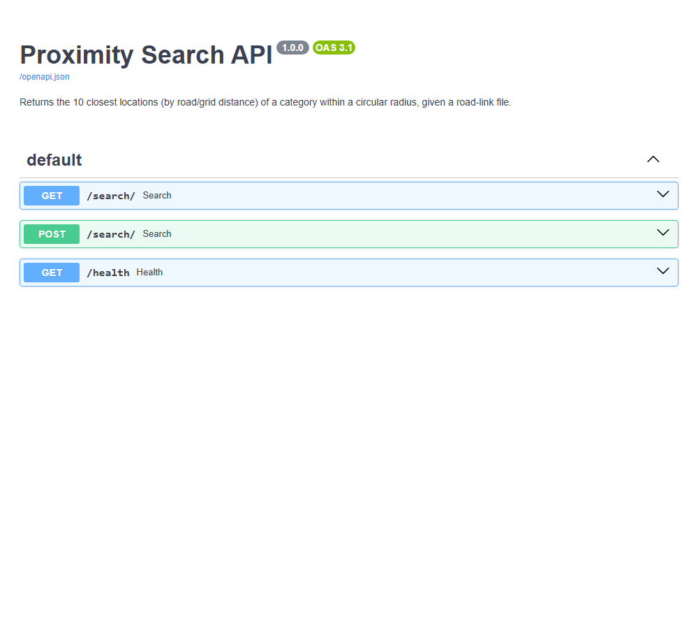
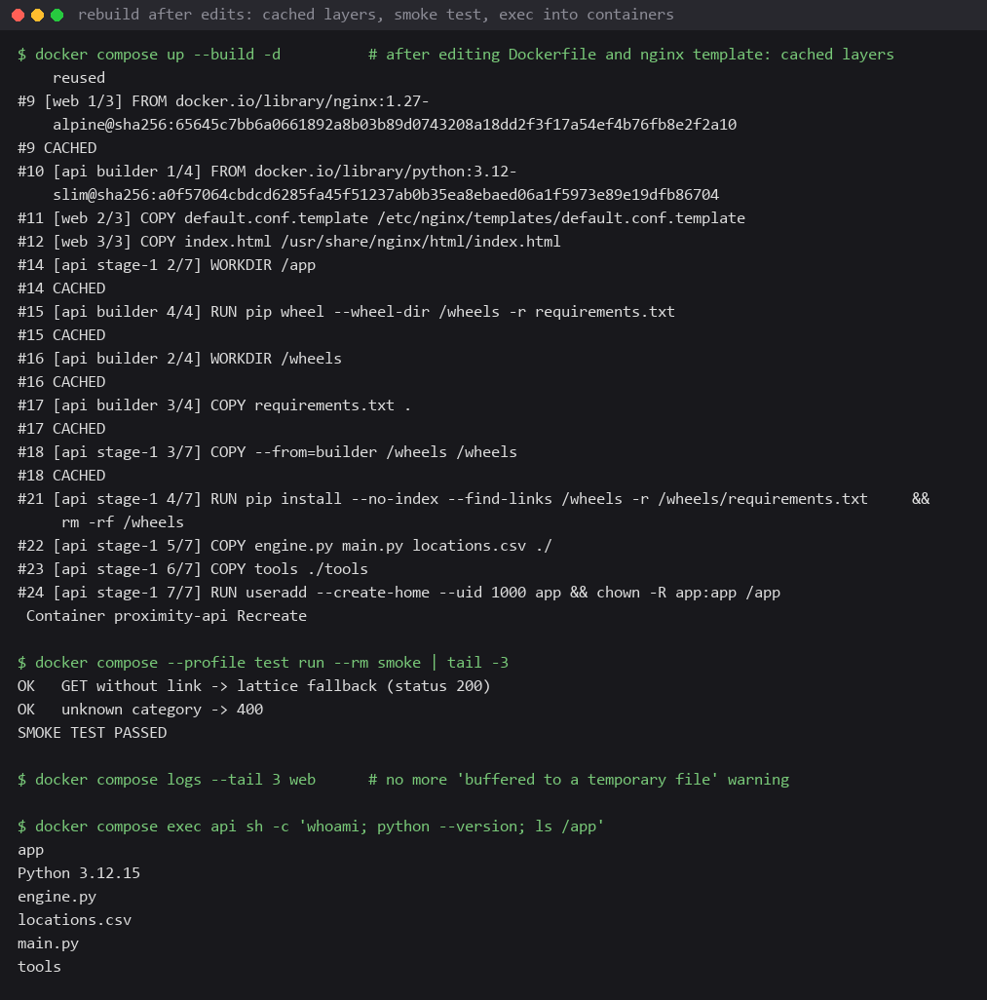
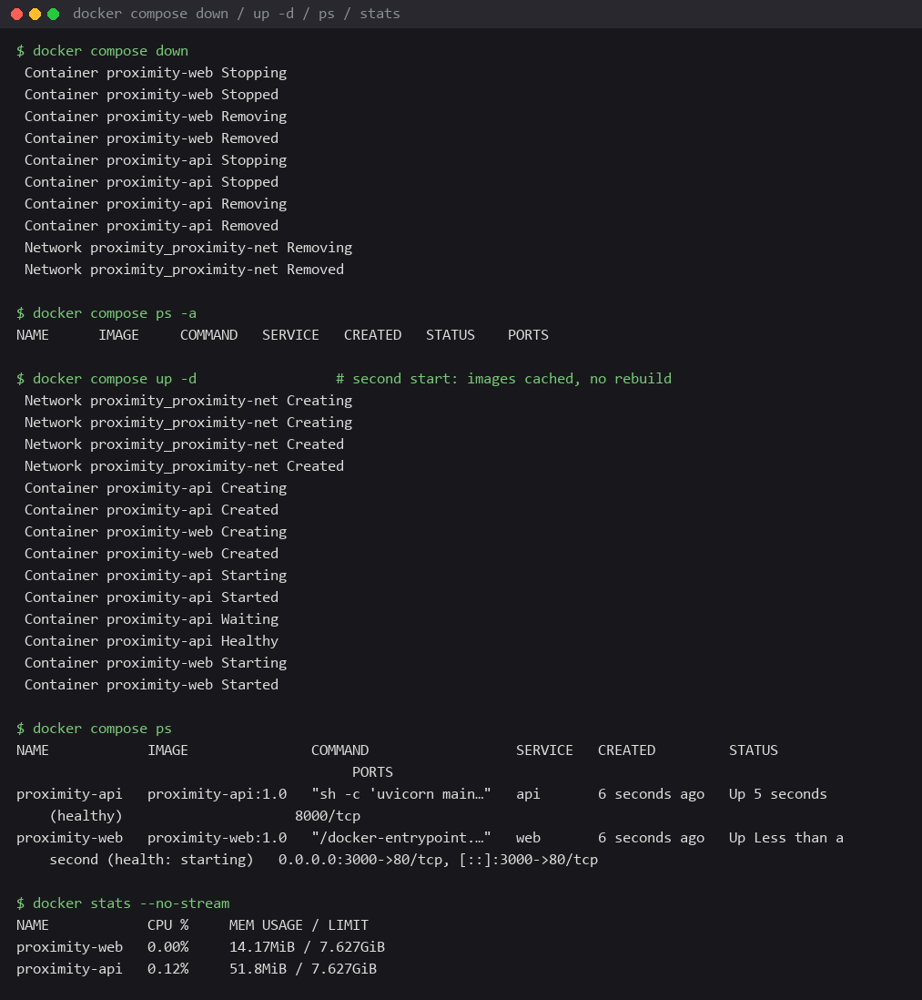

# Containerising the Proximity Search API: Report

**Author:** Om Anand (ID 12341510)  
**Repository:** <https://github.com/Om-A-osc/proximity>  
**Date:** 25 October 2026  
**System used:** personal laptop, Windows 11 Home, WSL 2 (Ubuntu 24.04.1 LTS), Docker Engine 29.9.2, Docker Compose v5.6.1

## 1. Objective and resulting stack

Lab 7 produced a FastAPI service that recommends the 10 nearest locations of a
category by road distance. This lab packages that service as a multi-container
stack that starts with a single command:

```bash
docker compose up --build -d
```

The stack has two long-running services and one optional one-shot service:

| service | image (built from)       | role                                                                 | reachable at             |
|---------|--------------------------|----------------------------------------------------------------------|--------------------------|
| `web`   | `web/Dockerfile` (nginx) | public entry point: serves a static search page, proxies API routes  | host port 3000           |
| `api`   | `Dockerfile` (Python)    | the FastAPI search engine                                            | `api:8000`, internal only |
| `smoke` | same image as `api`      | end-to-end test run on demand (`--profile test`)                     | not exposed              |

Request path: browser or grader → `localhost:3000` → nginx (`web`) → `http://api:8000`
over the private compose network → FastAPI → JSON back through nginx. Only nginx
publishes a port; the API cannot be reached from the host directly.

## 2. Docker design choices

### 2.1 Base images

* **`python:3.12-slim`** for the API. The Debian-slim variant is about 130 MB
  smaller than the full image and still ships a complete CPython; Alpine was
  avoided because NumPy wheels target glibc (manylinux), so Alpine would have
  compiled NumPy from source. 3.12 matches the Python on the course server where
  Lab 7 is deployed.
* **`nginx:1.27-alpine`** for the front end. nginx needs nothing from the OS, so
  the Alpine image (about 73 MB after adding the files) is the natural choice.
  The official image renders `/etc/nginx/templates/*.template` with `envsubst`
  at start-up, which is how the upstream address is injected from the
  environment.

### 2.2 API Dockerfile: multi-stage, non-root, health-checked

```dockerfile
FROM python:3.12-slim AS builder          # stage 1: build wheels only
WORKDIR /wheels
COPY requirements.txt .
RUN pip wheel --wheel-dir /wheels -r requirements.txt

FROM python:3.12-slim                     # stage 2: runtime image
ENV PYTHONDONTWRITEBYTECODE=1 PYTHONUNBUFFERED=1 PIP_NO_CACHE_DIR=1 \
    PIP_DISABLE_PIP_VERSION_CHECK=1 PIP_ROOT_USER_ACTION=ignore
WORKDIR /app
COPY --from=builder /wheels /wheels
RUN pip install --no-index --find-links /wheels -r /wheels/requirements.txt && rm -rf /wheels
COPY engine.py main.py locations.csv ./
COPY tools ./tools
RUN useradd --create-home --uid 1000 app && chown -R app:app /app
USER app
ENV PORT=8000 LOCATIONS_CSV=/app/locations.csv WORKERS=1 LOG_LEVEL=info
EXPOSE 8000
HEALTHCHECK --interval=10s --timeout=5s --start-period=10s --retries=5 \
    CMD python -c "import os,sys,urllib.request; sys.exit(0 if urllib.request.urlopen('http://127.0.0.1:%s/health' % os.environ.get('PORT','8000'), timeout=3).status == 200 else 1)"
CMD ["sh", "-c", "uvicorn main:app --host 0.0.0.0 --port ${PORT} --workers ${WORKERS} --log-level ${LOG_LEVEL}"]
```

* **Multi-stage build.** Stage 1 downloads/builds wheels; stage 2 installs from
  those wheels with `--no-index`. Compilers and pip's download cache never enter
  the final image, and the slow network step (215 s on the first build) is a
  cached layer that is only redone when `requirements.txt` changes. After
  editing the Dockerfile the rebuild took 4 s for the install step.
* **Layer order.** `requirements.txt` is copied and installed before the source
  files, so code edits do not invalidate the dependency layer.
* **Non-root user.** The process runs as `app` (uid 1000); `docker compose exec api whoami` prints `app`.
* **HEALTHCHECK** calls `/health` with the standard library, so no extra tool
  is installed. Compose uses it: `web` only starts once `api` is `healthy`.
* **Runtime configuration through environment variables** (`PORT`, `WORKERS`,
  `LOG_LEVEL`, `LOCATIONS_CSV`), read by the `CMD` and by the application.
* **`.dockerignore`** keeps `.git`, `__pycache__`, PDFs, Markdown, the `web`
  folder and sample link files out of the build context (78 KB of source goes
  in instead of the whole folder).

### 2.3 Web Dockerfile

```dockerfile
FROM nginx:1.27-alpine
COPY default.conf.template /etc/nginx/templates/default.conf.template
COPY index.html /usr/share/nginx/html/index.html
ENV API_UPSTREAM=http://api:8000 MAX_UPLOAD=50m NGINX_ENVSUBST_FILTER="^(API_UPSTREAM|MAX_UPLOAD)$"
EXPOSE 80
HEALTHCHECK --interval=15s --timeout=3s --start-period=5s --retries=3 CMD wget -qO- http://127.0.0.1/ > /dev/null || exit 1
```

The template proxies `/search`, `/health`, `/docs` and `/openapi.json` to
`${API_UPSTREAM}` and serves the static page for everything else.
`client_max_body_size ${MAX_UPLOAD}` allows large link-file uploads, and
`client_body_buffer_size 1m` keeps a typical link file (about 160 KB) in
memory. `NGINX_ENVSUBST_FILTER` restricts substitution to the two variables, so
nginx's own `$host` and `$uri` are left alone.

### 2.4 docker-compose.yml

```yaml
name: proximity
services:
  api:
    build: { context: ., dockerfile: Dockerfile }
    image: proximity-api:1.0
    container_name: proximity-api
    environment: { PORT: "8000", WORKERS: "${API_WORKERS:-1}", LOG_LEVEL: "${API_LOG_LEVEL:-info}", LOCATIONS_CSV: /app/locations.csv }
    volumes: [ "./locations.csv:/app/locations.csv:ro" ]
    expose: [ "8000" ]
    networks: [ proximity-net ]
    healthcheck: { test: [CMD, python, -c, "...urlopen('http://127.0.0.1:8000/health')..."], interval: 10s, timeout: 5s, retries: 5, start_period: 10s }
    restart: unless-stopped
  web:
    build: { context: ./web, dockerfile: Dockerfile }
    image: proximity-web:1.0
    container_name: proximity-web
    environment: { API_UPSTREAM: http://api:8000, MAX_UPLOAD: 50m }
    ports: [ "${WEB_PORT:-3000}:80" ]
    depends_on: { api: { condition: service_healthy } }
    networks: [ proximity-net ]
    restart: unless-stopped
  smoke:
    build: { context: ., dockerfile: Dockerfile }
    image: proximity-api:1.0
    profiles: [ test ]
    environment: { API_URL: http://web }
    command: [ python, tools/smoke.py ]
    depends_on: { web: { condition: service_started } }
    networks: [ proximity-net ]
networks:
  proximity-net: { driver: bridge }
```

| concern | choice | reason |
|---------|--------|--------|
| **ports** | only `web` publishes `${WEB_PORT:-3000}:80`; `api` uses `expose: 8000` | the grader needs one URL; the API stays private, which was verified with `curl localhost:8000` returning connection refused |
| **network** | one user-defined bridge `proximity-net` | compose's embedded DNS lets nginx reach the API by service name (`http://api:8000`); the default bridge has no name resolution |
| **volumes** | bind mount `./locations.csv` read-only into `api` | the dataset can be swapped without a rebuild; `:ro` because the service never writes. No named volume is needed: the service is stateless (link graphs are cached in memory per request content) |
| **environment variables** | `PORT`, `WORKERS`, `LOG_LEVEL`, `LOCATIONS_CSV` (api); `API_UPSTREAM`, `MAX_UPLOAD` (web); `WEB_PORT`, `API_WORKERS`, `API_LOG_LEVEL` (compose, with defaults) | one compose file works for a laptop and for a server; e.g. `WEB_PORT=8080 docker compose up -d` |
| **start-up order** | `depends_on` with `condition: service_healthy` | nginx resolves `api` at start, so the API must exist and answer first |
| **restart policy** | `unless-stopped` | the stack comes back by itself after a daemon or WSL restart (this actually happened, see section 4) |
| **profiles** | `smoke` is in profile `test` | `up` starts only the two services; `docker compose --profile test run --rm smoke` runs the test and removes its container |
| **image tags** | `proximity-api:1.0`, `proximity-web:1.0` | explicit names instead of compose's generated `proximity-api` / `proximity-web` with `latest` |

## 3. Steps followed

### 3.1 Install Docker (personal laptop, no Docker Desktop)

The laptop had no Docker at all. Instead of Docker Desktop, Docker Engine was
installed inside the existing WSL 2 Ubuntu distro from Docker's apt repository:

```bash
apt-get update && apt-get install -y ca-certificates curl gnupg
install -m 0755 -d /etc/apt/keyrings
curl -fsSL https://download.docker.com/linux/ubuntu/gpg | gpg --dearmor -o /etc/apt/keyrings/docker.gpg
echo "deb [arch=amd64 signed-by=/etc/apt/keyrings/docker.gpg] https://download.docker.com/linux/ubuntu noble stable" > /etc/apt/sources.list.d/docker.list
apt-get update && apt-get install -y docker-ce docker-ce-cli containerd.io docker-buildx-plugin docker-compose-plugin
systemctl enable --now docker
docker version && docker compose version
```



### 3.2 Build and start the stack

```bash
cd /mnt/c/Users/omana/OneDrive/Desktop/CSD_ASSIGNS/proximity
docker compose config --quiet        # validate the compose file
docker compose up --build -d         # build both images, create network, start
docker compose ps
```

The first build pulled `python:3.12-slim` and `nginx:1.27-alpine`, built the
wheels (215 s, the only slow step), and started the containers; compose waited
for `api` to report healthy before starting `web`.



### 3.3 Verify

```bash
docker images | grep proximity                    # 385 MB api, 73.6 MB web
docker network ls | grep proximity                # proximity_proximity-net (bridge)
docker inspect proximity-api --format '{{.State.Health.Status}} user={{.Config.User}}'
curl http://localhost:3000/health                 # through nginx
curl 'http://localhost:3000/search/?lat=0.5&long=0.5&cat=bank&rad=0.2'
curl http://localhost:8000/health                 # must fail: API is not published
docker compose --profile test run --rm smoke      # end-to-end test
```



The smoke test container generates a link file (lattice minus 15 % of the
links), posts five multipart queries through nginx, compares each answer with
the engine computed locally, and checks the lattice fallback and a 400 error:



The front end and the API documentation, both served through port 3000:





### 3.4 Rebuild after changes, stop and restart

After editing the Dockerfile (pip warning) and the nginx template (buffer
size), `docker compose up --build -d` rebuilt only what changed: every `api`
layer up to the wheel install came from cache, the install from cached wheels
took 4 s, and only `api` was recreated. `docker compose exec` was used to look
inside both containers, then the stack was taken down and brought up again.





## 4. Errors and problems faced, and how they were resolved

| # | problem | cause | resolution |
|---|---------|-------|------------|
| 1 | `docker: command not found` on Windows and inside WSL | Docker was not installed; Docker Desktop was not wanted | installed Docker Engine + Compose plugin inside WSL 2 Ubuntu from the official apt repository (section 3.1) |
| 2 | first `docker compose up --build` took about 4 minutes | `pip wheel` downloaded NumPy, FastAPI, uvicorn and friends over a slow connection (215 s) | nothing to fix for the first build; the multi-stage layout turns this into a cached layer, and the rebuild after code/Dockerfile edits took 4 s |
| 3 | build log: `WARNING: Running pip as the 'root' user ...` | pip runs as root during the image build (expected) | set `PIP_ROOT_USER_ACTION=ignore` in the Dockerfile `ENV`; the rebuild is warning-free |
| 4 | nginx log: `a client request body is buffered to a temporary file` on every link-file upload | nginx's default body buffer is 16 KB, link files are about 160 KB | added `client_body_buffer_size 1m;` to the template; rebuilt `web`; the warning disappeared |
| 5 | `docker compose ps` showed `Up 1 second` for containers created 46 s earlier; the WSL distro showed `Stopped` between commands | WSL 2 shuts the distro down when no session is open, which stops the Docker daemon and its containers | `restart: unless-stopped` made the stack come back on its own at the next boot (`StartedAt` later than `Created`, `RestartCount` 0). For continuous availability keep a WSL terminal open, or set `vmIdleTimeout` in `%USERPROFILE%\.wslconfig` |

## 5. Docker commands used

In order of use:

```bash
docker version --format '{{.Client.Version}} / {{.Server.Version}}'
docker compose version
docker compose config --quiet
docker compose up --build -d
docker compose ps
docker images
docker network ls
docker inspect proximity-api --format '{{.State.Health.Status}} user={{.Config.User}} ports={{.NetworkSettings.Ports}}'
docker inspect proximity-web --format '{{.State.Health.Status}} ports={{.NetworkSettings.Ports}}'
docker compose --profile test run --rm smoke
docker compose logs --tail 6 api
docker compose logs --tail 4 web
docker inspect proximity-api proximity-web --format '{{.Name}} created={{.Created}} started={{.State.StartedAt}} restarts={{.RestartCount}}'
docker events --since 10m --filter type=container
docker compose up --build -d            # after edits
docker compose exec api sh -c 'whoami; python --version; ls /app'
docker compose exec web nginx -T
docker compose down
docker compose ps -a
docker compose up -d
docker stats --no-stream
```

Unique commands and their purpose:

| command | purpose |
|---------|---------|
| `docker version` / `docker compose version` | confirm client, daemon and compose plugin versions |
| `docker compose config --quiet` | parse and validate `docker-compose.yml` without starting anything |
| `docker compose up --build -d` | build images that are out of date, create the network and containers, start them detached; the "one command" |
| `docker compose up -d` | start from existing images, no build |
| `docker compose ps` / `ps -a` | list the stack's containers with health and port mappings |
| `docker compose logs --tail N <service>` | read a service's recent stdout/stderr |
| `docker compose exec <service> <cmd>` | run a command inside a running container (checked user, Python version, rendered nginx config) |
| `docker compose --profile test run --rm smoke` | start the optional one-shot test service and remove its container afterwards |
| `docker compose down` | stop and remove containers and the network (images and the bind-mounted file stay) |
| `docker images` | list built images and their sizes |
| `docker network ls` | list networks; shows the project's bridge network |
| `docker inspect --format` | read container metadata: health status, user, port bindings, timestamps, restart count |
| `docker events` | stream daemon events, used while diagnosing the restart |
| `docker stats --no-stream` | one-off CPU and memory usage per container |
| `curl` | hit `/health` and `/search/` through nginx and prove port 8000 is closed |

## 6. What I learnt

* **Compose is the orchestration unit, not the Dockerfile.** Ports, the
  network, the volume, the environment, start-up order and restart policy all
  live in `docker-compose.yml`; each Dockerfile only describes one image.
* **Service names are DNS names.** On a user-defined network nginx reaches the
  API as `http://api:8000`; nothing needs an IP address. The default bridge
  network does not offer this.
* **`expose` versus `ports`.** `expose` only documents a container port on the
  internal network; `ports` publishes it on the host. Keeping the API on
  `expose` is what makes nginx the single entry point.
* **Health checks make `depends_on` meaningful.** Without
  `condition: service_healthy`, nginx can start before the API accepts
  connections and fail to resolve the upstream.
* **Layer caching rewards ordering.** Dependencies before source, and a
  separate wheel-building stage, turned a 4-minute build into a 4-second
  rebuild.
* **Images should not run as root**, and `USER` plus a `chown` is all it takes
  for a Python service.
* **Configuration belongs in the environment.** The same images run on port
  3000 locally or on any other port by changing a variable, and nginx's
  upstream is a template value, not a rebuild.
* **The host matters.** Docker Engine in WSL 2 works without Docker Desktop,
  but the distro's idle shutdown stops containers; a restart policy and a
  keep-alive session or `vmIdleTimeout` deal with it.
* **A smoke test as a compose profile** gives a repeatable, one-command check
  of the whole stack that does not run on every `up`.

## 7. Files added or changed in the repository

| file | purpose |
|------|---------|
| `Dockerfile` | API image (multi-stage, non-root, healthcheck) |
| `.dockerignore` | keeps the build context small |
| `web/Dockerfile` | nginx image |
| `web/default.conf.template` | nginx config rendered from environment variables |
| `web/index.html` | static front end served by nginx |
| `docker-compose.yml` | the stack: `api`, `web`, optional `smoke`, network, volume |
| `tools/smoke.py` | end-to-end test used by the `smoke` service |
| `report_assets/` | screenshots used in this report |
